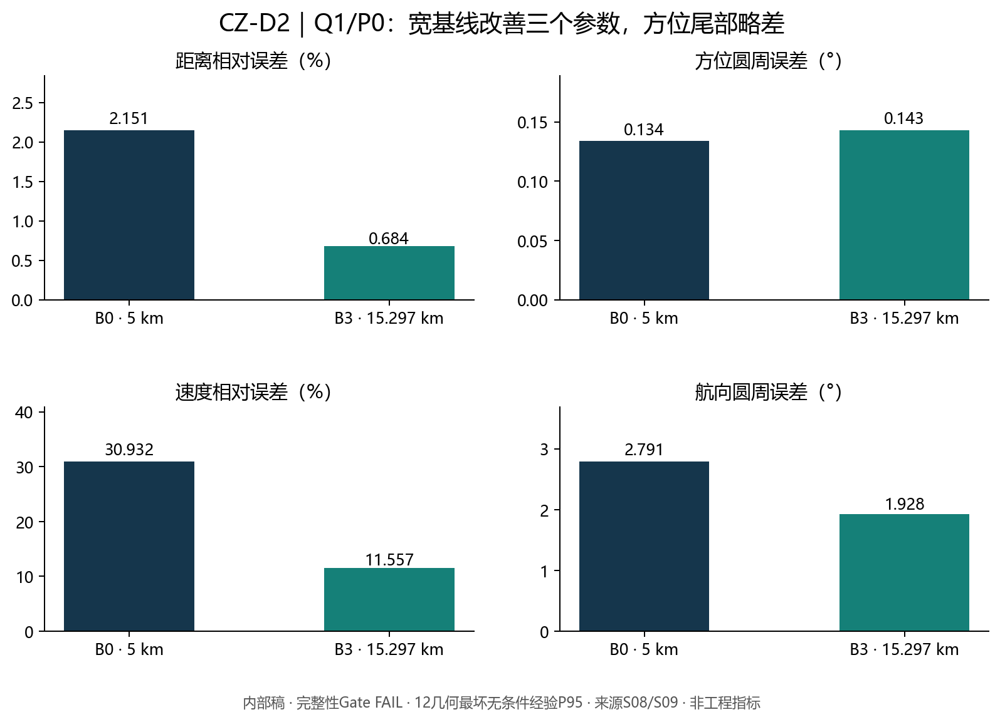
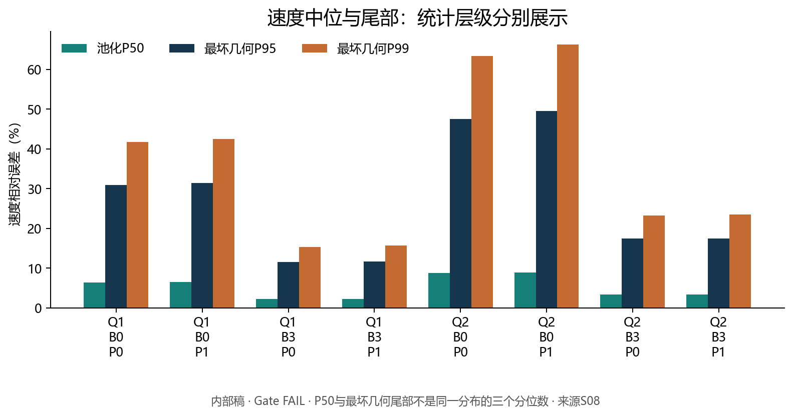
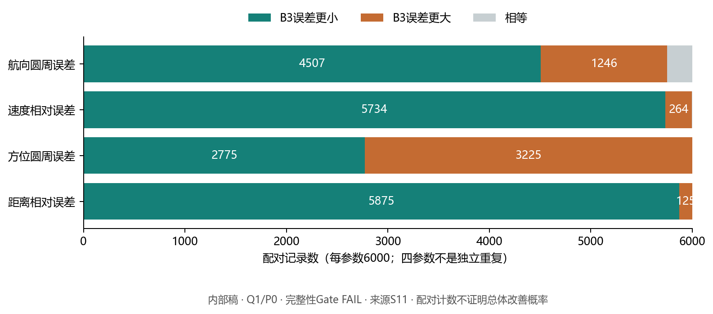
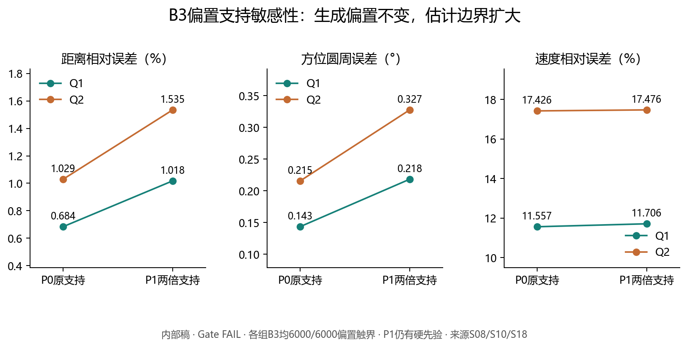

# 716第一会聚区多参数定位：首次阶段性交付内部技术报告

内部审阅稿｜未批准对外发送｜CZ-D2完整性Gate保持FAIL

基于CZ-D2提交 `8147352b50168ce0f747aa2e42801bf7a2d13b35`；历史CZ-D1最终提交 `a580499475cc4148f1195e6256c4813c6e225726`。

## 1. 交付结论与审阅范围

本稿用于716项目首次阶段性交付的内部审阅，尚未批准向甲方发送或作为性能验收文件。研究目标是“输入观测条件与精度 → 五维状态输出精度 → 适用边界与资源需求”。当前不能承诺原单平台单HLA的五维联合精度。

原单HLA是主线。已有成果包括机动与多频候选区分、源未知量消除机制、假设径向特征对速度的潜力，以及接收提取的具体失败边界。增强方案作为条件参照：短垂向观测有局部深度信息增量，双节点有四参数经验误差分布；它们尚不能组成已验证的五维系统。

CZ-D1限定范围归并结论已获负责人接受。CZ-D2完成48,000项计算，保留较强数值一致性证据，但冻结完整性Gate仍为FAIL，整体科研PASS不予授予。负责人接受标准库缓存访问解释并允许本轮内部编稿，不构成原Gate追认。所有CZ-D2精度均按“有完整数值证据、存在完整性例外的条件性仿真结果”引用。

本轮仅读取保存的表格与文档、进行展示转换和表间一致性检查。不重新访问并复算全部D盘原始观测，不运行传播、优化、Monte Carlo、Fisher或冷审计。main、历史Gate和R4=0%保持。

## 2. 指标定义与证据等级

状态顺序为距离r、方位θ、深度z、速度v、航向ψ。相对误差逐样本除以真实r或v；角误差为最小圆周差（度）。深度未评估写NOT_EVALUATED，不填0。拒判和数值失败计INF；未执行与失败分开。分位数继承nearest-rank，不对INF插值。

证据分为：①解析或局部信息；②有限离散候选；③假设观测下的连续估计误差；④合成接收数据实际提取；⑤真实设备/海域验证。类别不同，不构成可直接排序的精度排行榜。已有材料未形成第⑤类工程能力认证。

统一对照表主P50为各几何P50的等权算术均值，P95为最坏几何无条件P95；另列CZ-D2池化P50。二者不是同一分布的分位数对。最坏场景可随参数和配置变化；两个最坏P95相减不是逐样本配对误差差的P95。

H2每几何32次、AUX-D1每几何128次、T3-W1及CZ-D2每几何500次。有限面板P95均为探索性经验统计，没有总体95%置信保证。配置和历元不能当作独立航迹；CZ-D2的48,000项配置来自6,000组配对基础创新。

## 3. 原单HLA及机动：可以交付的进展

原阵名义8元、2 m间距、14 m孔径。AUX-D1 U0与H2 B分别提供各自合同内的方位基线，并不穷尽原阵声学能力，也不是原阵物理极限。

历史R3同合同转角0/2/5/10/15°对照中，MAIN、源深180 m、τ=0.5 dB的RC2-only距离跨度均为15 km；结合RC3后，仅15°实例收至4 km。该数值是有限候选跨度，不是连续测距误差。多数后续实验本已采用600 s后15°转向，不能将整套增强收益归功于机动。

最终114,576→2标签是理论机制验证，最终两候选仅航向4°/5°不同，不作为主要性能成果或连续零误差。未建立转角、时长到四参数P95的完整函数。

H1证明公共源幅剖面化的条件价值，但冻结离网格声学搜索没有建立可接受解；未找到解不能当作物理信息不存在。H2主U条件注入六窗径向幅值（σ=0.05 m/s），速度场景等权中位误差约0.7538%，最坏几何无条件P95仍为INF。原始声压到该特征的映射未准入，不能把注入精度当作设备能力。[S02–S05]

## 4. 历史条件精度：保留收益与失败分母

| 实验/配置 | 距离 P50/P95 % | 方位 P50/P95 ° | 速度 P50/P95 % | 航向 P50/P95 ° | 输出/计划 |
|---|---|---|---|---|---|
| H2 B_0 | 6.496 / INF | 0.014 / INF | 33.595 / INF | 1.974 / INF | 250/256 |
| H2 U_0.05 | 6.593 / INF | 0.013 / INF | 0.754 / INF | 0.720 / INF | 250/256 |
| AUX-D1 U0 | 9.608 / 19.265 | 0.030 / 0.093 | 48.432 / 95.546 | 2.207 / 7.869 | 1536/1536 |
| AUX-D1 U5 | 0.489 / 1.296 | 0.029 / 0.092 | 7.381 / 31.163 | 0.354 / 2.939 | 1536/1536 |
| T3-W1 Q1_B0 | 0.969 / 2.192 | 0.048 / 0.131 | 7.702 / 27.397 | 0.388 / 2.562 | 6000/6000 |
| T3-W1 Q1_B3 | 0.304 / 0.703 | 0.058 / 0.141 | 2.423 / 8.566 | 0.277 / 1.222 | 6000/6000 |
| T3-W1 Q2_B3 | 0.457 / 1.058 | 0.087 / 0.212 | 3.647 / 12.868 | 0.414 / 1.835 | 6000/6000 |

P50为场景等权中位误差汇总，P95为最坏场景无条件P95。各行深度NOT_EVALUATED。各实验有不同目标面板、估计器与误差合同，只能在同实验内作资源对照；禁止跨行解释为单因素算法优劣。[S02/S03]

H2：方位σ=0.1°、精确导航、有符号方位、1200 s及六个200 s径向窗；U主档零点已校准但接近/远离符号未知。250/256输出不是250次精度达标。
AUX-D1：U0/U5配对同一主节点观测；随机方位0.05°、导航25 m/轴、共模±0.05°、半差±0.025°及布放偏角±10°，四状态稳健处理器不估固定偏置。
T3-W1：B0和B3都是双节点，使用偏置有界估计，不能冒充原单HLA对照。Q1/Q2定义见下一节；所有历史数字仅为其冻结模型条件。

## 5. 深度、倾斜、环境与接收链边界

H3短垂向B1相对等通道共深B2的局部深度信息比为2.3407–4.4743，依赖名义环境、校准和局部水平状态剖面。不能将信息比转为误差改善倍数或米级深度P95。宽水平多分支、环境传播及实际提取仍是必要关口。

T2倾斜阵及短垂向阵的定位性能未准入；前向数值失败与理想波导精度归因不等于阵型物理无效。旧T2/FUNC2修补链保持关闭，本稿不提出继续加密或补跑。

NUM03支持单一WOA来源族下的名义第一深折返几何，两种SSP表示对照不等于真实海域传播稳健性。非相干能量、相干模态、可检测性与工程覆盖必须分别论证。CZO04揭示每历元自由源级可吸收单频强度变化，当前单频包络不构成一般可靠距离锚。

CAP06 CAL/20 dB主条件：21,378/22,648目标存在历元被角度候选覆盖，94.3924%低于冻结95%门；这不是四维目标精度或独立航迹成功率。未校准10/20 dB无目标分量提取输出，O2前向未准入，P3融合未执行。不得用较易子集替代主条件。其原始哈希与冷检查属于历史执行证据，本稿未再做全量复算。[S03/S05/S06]

## 6. CZ-D2观测合同与独立样本口径

B0辅助偏移(0,±5) km；B3为(3,±15) km，节点间距15.297 km。两节点保持全局固定偏移共速平移，主平台2 m/s、600 s后转15°，1200 s/121历元。两侧布放分层不等于原HLA左右舷消歧。

Q1：每节点随机方位σ=0.05°，导航每轴每历元25 m；固定共同偏置c~Uniform±0.05°，差模半差d~Uniform±0.025°。Q2相应为0.075°、37.5 m、±0.075°、±0.0375°；Q2同时改变多个条件，不能归因于单一测向精度。

主/辅偏置为c−d与c+d。P0按原支持估计，P1仅将两偏置估计支持扩大2倍；生成偏置仍处P0范围。P1仍是有先验估计，不是实际超界偏置失配试验。归一化尺度变化影响TRF数值轨迹，结果称“冻结处理器的偏置支持敏感性”。

新面板12个预注册离网格状态，每状态500次、每侧250次；6,000组基础创新配对8配置，24,000条公开资源记录，48,000终点。它不是保密外部盲测集。生成代码在面板物化前冻结，V3排除762条身份按已审计范围绑定。

物理状态域r∈[45,60] km、θ∈[−5,5]°、v∈[1,3] m/s、ψ∈[−15,15]°。估计器仅读取公开时间、报告位置与有符号方位，单次局部TRF终点；没有全局最优和连续分支覆盖证书。实际同步、目标关联、有符号测向与偏置范围均为假设。[S18/S19]

## 7. CZ-D2四参数经验P95：完整八组配置

| 配置 | 距离 % | 方位 ° | 速度 % | 航向 ° |
|---|---|---|---|---|
| Q1_B0_P0 | 2.151 | 0.134 | 30.932 | 2.791 |
| Q1_B0_P1 | 3.167 | 0.208 | 31.451 | 3.067 |
| Q1_B3_P0 | 0.684 | 0.143 | 11.557 | 1.928 |
| Q1_B3_P1 | 1.018 | 0.218 | 11.706 | 1.970 |
| Q2_B0_P0 | 3.167 | 0.208 | 47.533 | 3.950 |
| Q2_B0_P1 | 4.703 | 0.314 | 49.528 | 4.350 |
| Q2_B3_P0 | 1.029 | 0.215 | 17.426 | 2.791 |
| Q2_B3_P1 | 1.535 | 0.327 | 17.476 | 2.791 |

以上为12几何最坏无条件经验P95，全部深度NOT_EVALUATED；原冻结完整性Gate FAIL。每配置6,000/6,000返回满足数值接受条件的终点，接受率100%不表示定位正确率100%。[S08–S10]

Q1/P0：B3距离、速度、航向尾部优于B0，方位略差。速度最坏P95由30.9322%降至11.5570%，两最坏统计量相对减少约62.6%，不是同一记录的改善百分比。旧T3-W1 Q1/B3为8.5659%，新面板未达到该数字，不能据此承诺全部适用几何速度误差低于10%。

Q2/P0的B3速度最坏P95约17.426%。本次表间抄录检查使用档案原值；用户审阅给出的四舍五入末位与表格显示可能不同，精确值以CSV为准。没有把5%或10%设为甲方验收线。

## 8. 中位、尾部、分侧和配对结果

各格为“场景等权P50 / 池化P50”，单位同列标题。[S08]

| 配置 | 距离 % | 方位 ° | 速度 % | 航向 ° |
|---|---|---|---|---|
| Q1_B0_P0 | 0.920 / 0.919 | 0.047 / 0.047 | 7.003 / 6.353 | 0.587 / 0.525 |
| Q1_B0_P1 | 1.811 / 1.739 | 0.084 / 0.084 | 6.997 / 6.443 | 0.607 / 0.536 |
| Q1_B3_P0 | 0.289 / 0.287 | 0.057 / 0.056 | 2.395 / 2.226 | 0.303 / 0.273 |
| Q1_B3_P1 | 0.582 / 0.578 | 0.114 / 0.114 | 2.405 / 2.256 | 0.311 / 0.279 |
| Q2_B0_P0 | 1.393 / 1.388 | 0.071 / 0.071 | 9.901 / 8.728 | 0.804 / 0.721 |
| Q2_B0_P1 | 2.681 / 2.646 | 0.129 / 0.130 | 9.960 / 8.923 | 0.843 / 0.721 |
| Q2_B3_P0 | 0.434 / 0.431 | 0.086 / 0.085 | 3.553 / 3.302 | 0.448 / 0.409 |
| Q2_B3_P1 | 0.875 / 0.870 | 0.172 / 0.174 | 3.589 / 3.349 | 0.459 / 0.422 |

最坏场景无条件P99（不是总体置信上界）：

| 配置 | 距离 % | 方位 ° | 速度 % | 航向 ° |
|---|---|---|---|---|
| Q1_B0_P0 | 2.434 | 0.165 | 41.720 | 4.391 |
| Q1_B0_P1 | 3.314 | 0.240 | 42.458 | 4.548 |
| Q1_B3_P0 | 0.773 | 0.173 | 15.352 | 2.644 |
| Q1_B3_P1 | 1.117 | 0.248 | 15.733 | 2.760 |
| Q2_B0_P0 | 3.441 | 0.246 | 63.389 | 5.379 |
| Q2_B0_P1 | 5.057 | 0.359 | 66.301 | 5.714 |
| Q2_B3_P0 | 1.177 | 0.261 | 23.231 | 3.382 |
| Q2_B3_P1 | 1.667 | 0.373 | 23.502 | 3.524 |

Q1/P0、B3相对B0逐记录配对：

| 参数 | 误差更小 | 误差更大 | 相等 | 配对分母 |
|---|---|---|---|---|
| 距离相对误差 | 5875 | 125 | 0 | 6000 |
| 方位圆周误差 | 2775 | 3225 | 0 | 6000 |
| 速度相对误差 | 5734 | 264 | 2 | 6000 |
| 航向圆周误差 | 4507 | 1246 | 247 | 6000 |

全部逐几何、正负侧、池化、条件/无条件P50/P90/P95/P99见D2_SCENE_AND_SIDE_QUANTILES.csv；所有配置配对与失败转移见D2_PAIRED_CHANGES.csv。两侧各250/场景、合计各3,000/配置，不能把两侧当两批独立目标。单参数更好记录数不代表四参数联合准确率。

## 9. 偏置触界、物理边界与估计风险

| 配置 | 数值接受/计划 | 至少一偏置触界 | 至少一物理状态触界 | 超过原偏置支持 |
|---|---|---|---|---|
| Q1_B0_P0 | 6000/6000 | 5998 | 1144 | 0 |
| Q1_B0_P1 | 6000/6000 | 5998 | 1513 | 6000 |
| Q1_B3_P0 | 6000/6000 | 6000 | 310 | 0 |
| Q1_B3_P1 | 6000/6000 | 6000 | 361 | 6000 |
| Q2_B0_P0 | 6000/6000 | 5999 | 1695 | 0 |
| Q2_B0_P1 | 6000/6000 | 5999 | 2245 | 5999 |
| Q2_B3_P0 | 6000/6000 | 6000 | 483 | 0 |
| Q2_B3_P1 | 6000/6000 | 6000 | 585 | 6000 |

触界沿用归一化tol=1e−6，P1尺度扩大使其物理容差相应变化。P1超过原P0支持不等于超出当前估计域，也不是生成器发生超界。物理状态触界、单局部终点和极高偏置触界率都限制了可交付措辞。

Q1/B3放宽支持后，距离P95约0.684%→1.018%，方位0.143°→0.218°，速度11.557%→11.706%。数据似然在同一物理状态下不变，不能把所有差异都归于物理信息减少。无硬支持的局部Fisher与有界Monte Carlo不是同一统计对象；不把局部1.96σ当经验P95或将Uniform改为Gaussian先验。

D2_BOUNDARY_AND_TAIL.csv保留逐侧和池化的大误差计数：距离10%、方位0.5°、速度20%、航向5°仅为原描述性尾部标尺，不是接受条件或工程要求。[S10/S18/S19]

## 10. 完整性例外必须与数值结果同时披露

正式主分析一次、独立冷审计一次、重试零；48,000/48,000配置完成。冷审计539,763 PASS、1 FAIL，返回非零状态，integrity_pass=false保持。32项四参数最坏P95的表间一致性不能代替该冷审计，更不能抵消失败。

唯一失败private_read_isolation的冻结判据要求denied==[]，并要求成功读取不含私有/panel路径。日志拒绝zipfile与encodings.cp437两份标准库.pyc缓存，随后成功读取对应源代码。记录中没有成功私有真值读取路径；负责人接受缓存回退解释。

可使用的表述：NO_SUCCESSFUL_PRIVATE_READ_OBSERVED_IN_RECORDED_TRACE。不能使用：PRIVATE_DATA_ISOLATION_FULLY_CERTIFIED。Python审计钩子不是操作系统级沙箱，拒绝日志没有完整打开标志。整体科学PASS不授予。

本稿不修改原审计、代码或STOP，不重跑48,000配置，也不建议以修审计后重跑取得PASS。早期H2严格相等FAIL、REPAIR的671 PASS/1 FAIL及14项补充检查同样保持原身份。新的负责人裁决单独保存，不追溯覆盖历史。[S13–S17]

## 11. 资源需求与适用范围

| 架构 | 资源变化 | 已有证据 | 仍缺条件 |
|---|---|---|---|
| A0 原8元、14 m HLA | 原资源 | 有符号方位的条件基线；多频有限候选机制 | 原始同步复数据、阵形和通道标定、左右舷与干扰处理 |
| A1 单HLA＋机动 | 0/2/5/10/15°与1200 s航迹 | 特定RC2+RC3 15°例距离候选跨度4 km；RC2-only仍15 km | 可实施机动、拖阵姿态与导航误差；需同合同配对证据 |
| A2 单HLA＋附加声学特征 | 三频或六窗径向特征假设 | H1公共源幅剖面机制；H2速度中位收益 | 可跟踪谱线、源频参考、符号/零点、增益及传播映射 |
| A3 HLA＋短垂向 | 增加4通道、4 m垂向跨度 | 局部深度信息比2.3407–4.4743（相对等通道共深对照） | 同步、差分增益、阵形、可信传播与实际相对观测 |
| A4 整体倾斜8元 | 原通道，姿态控制 | 前向精度诊断和误差归因 | 可信相干前向及姿态合同；旧T2/FUNC2链保持关闭 |
| A5 HLA＋辅助节点 | 第二接收节点；5–15.297 km | AUX/T3条件四参数；D2有完整性例外的泛化结果 | 部署、导航、同步、同目标关联、可用有符号测向、偏置依据 |
| A6 联合增强 | 仅计实际已做组合 | 已测试的转向＋辅助列于各自合同 | 逐观测准入后取得同批联合输入；无已验证Pareto前沿 |

资源表描述观测必要条件与已测试名义配置，不是最低装备数量、价格、可达精度保证或已验证Pareto边界。原HLA缺失的信号信息不能仅靠算法承诺补回。

| 几何 | 节点间距km | 辅助距离最小/最大km | 辅助域外历元/2904 |
|---|---|---|---|
| B0 | 5.000 | 45.124 / 59.441 | 0/2904 |
| B3 | 15.297 | 44.183 / 58.544 | 129/2904 |

几何统计取24条名义目标—侧向组合轨迹，每条121历元，Q1/Q2相同名义轨迹只计一次。45–60 km只是历史研究范围，不能证明第一CZ探测覆盖；域外值保留，不删不换面板。实际15 km级部署、测向能力和海域覆盖仍需独立证据。[S12/S18]

后续资料优先级：①原8元同步复基带、时间戳、AGC和阵元标定；②拖阵姿态、阵形与导航协方差；③谱线连续性、源频参考和干扰分量；④SSP/海深/底质及变化范围；⑤辅助节点同步、同目标关联、左右舷判别与偏置标定；⑥短垂向附加通道的差分增益与部署条件。当前均不能从模拟参数反推设备已经具备能力。

## 12. 对外措辞清单与收口决定

可写：原单HLA完成多条条件机制及能力边界研究；给出假设观测到状态误差的可追溯证据，深度和实际接收链仍需验证。可写：增加辅助节点在给定测向、导航和偏置支持下改善部分水平参数，CZ-D2保留完整性例外。

不可写：单HLA已实现五维联合小于10%；100%接受等于100%定位正确；局部深度信息增益等于米级测深；B3对全部参数均更优；P1验证任意超界偏置鲁棒；9个名义环境单元等于9个海域；通过修正说明将原冷审计改成全PASS。

申报研究问题应落在“第一CZ条件下，可提取观测如何解除状态与源、增益、偏置、环境之间的退化，以及代价是什么”。已有正、负证据均可支持问题定义，尚不能构成工程性能验收。

本轮完成内部技术报告、图件、条件表和PPT草稿后STOP。下一步仅等待负责人审查指标措辞、证据等级和例外披露；未授权发送甲方，未授权新实验，CZ-D2数值路线收口。

## 附录：来源索引

| 编号 | 固定快照来源 |
|---|---|
| S01 | [CZ_D1_EVIDENCE_MASTER.csv](../CZ_D1/CZ_D1_EVIDENCE_MASTER.csv) |
| S02 | [CZ_D1_RECOMPUTED_CONFIG_SUMMARY.csv](../CZ_D1/CZ_D1_RECOMPUTED_CONFIG_SUMMARY.csv) |
| S03 | [CZ_D1_ARCHITECTURE_METRICS.md](../CZ_D1/CZ_D1_ARCHITECTURE_METRICS.md) |
| S04 | [CZ_D1_MANEUVERS_AND_AUGMENTATIONS.md](../CZ_D1/CZ_D1_MANEUVERS_AND_AUGMENTATIONS.md) |
| S05 | [CZ_D1_NEGATIVE_GATES_AND_GAPS.md](../CZ_D1/CZ_D1_NEGATIVE_GATES_AND_GAPS.md) |
| S06 | [CZ_D1_CAP06_RECALCULATED.csv](../CZ_D1/CZ_D1_CAP06_RECALCULATED.csv) |
| S07 | [CZ_D1_INPUT_CONTRACTS.json](../CZ_D1/CZ_D1_INPUT_CONTRACTS.json) |
| S08 | [AGGREGATES.csv](../CZ_D2/COMMIT_B_RESUME_01/AGGREGATES.csv) |
| S09 | [STATISTICS.csv](../CZ_D2/COMMIT_B_RESUME_01/STATISTICS.csv) |
| S10 | [OUTPUT_AND_BOUNDARY_DIAGNOSTICS.csv](../CZ_D2/COMMIT_B_RESUME_01/OUTPUT_AND_BOUNDARY_DIAGNOSTICS.csv) |
| S11 | [PAIRED_COMPARISONS.csv](../CZ_D2/COMMIT_B_RESUME_01/PAIRED_COMPARISONS.csv) |
| S12 | [RESOURCE_GEOMETRY.csv](../CZ_D2/COMMIT_B_RESUME_01/RESOURCE_GEOMETRY.csv) |
| S13 | [COLD_AUDIT.json](../CZ_D2/COMMIT_B_RESUME_01/COLD_AUDIT.json) |
| S14 | [AUDIT_FAILURE_SCOPE_NOTE.json](../CZ_D2/COMMIT_B_RESUME_01/AUDIT_FAILURE_SCOPE_NOTE.json) |
| S15 | [CZ_D2_FINAL_DECISION.json](../CZ_D2/COMMIT_B_RESUME_01/CZ_D2_FINAL_DECISION.json) |
| S16 | [PRODUCTION_PREFLIGHT.json](../CZ_D2/COMMIT_B_RESUME_01/PRODUCTION_PREFLIGHT.json) |
| S17 | [EXECUTION_BUDGET.json](../CZ_D2/COMMIT_B_RESUME_01/EXECUTION_BUDGET.json) |
| S18 | [EXPERIMENT_CONTRACT.md](../CZ_D2/EXPERIMENT_CONTRACT.md) |
| S19 | [GATE_AND_STATISTICS.md](../CZ_D2/GATE_AND_STATISTICS.md) |

全部路径、SHA256、固定快照与用途见SOURCE_INDEX.csv；逐项措辞见CLAIM_EVIDENCE_LEDGER.csv。
